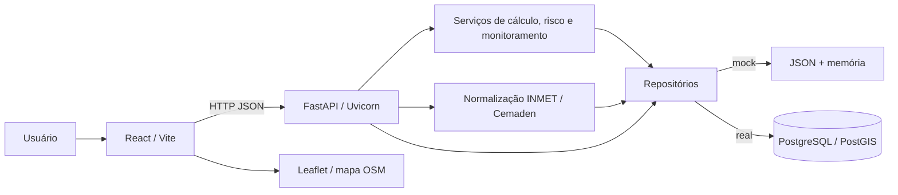
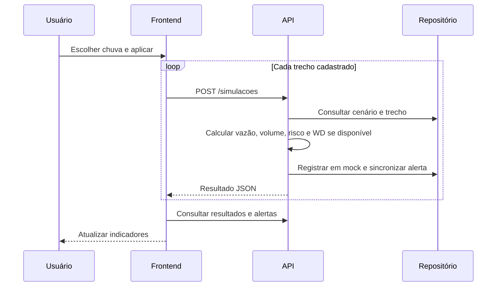

# Arquitetura do sistema

Aplicação web cliente-servidor, com backend modular FastAPI (não um conjunto de microsserviços implantados), interface React/Vite e dois modos de persistência.

| Caminho | Responsabilidade |
|---|---|
| backend/app/main.py | Composição da API, CORS, chave, health, mapa e simulações |
| backend/app/api/routes/ | Rodovias, trechos, análises, meteorologia, alertas e localização |
| backend/app/schemas/ | Contratos Pydantic e validação de entrada |
| backend/app/core/ | Configuração e conexão ao banco |
| backend/app/services/ | Hidrologia, classificação, alertas, correspondência geográfica |
| backend/app/repositories/ | Abstração mock/real, consultas e persistência |
| backend/app/integrations/ | Normalização e módulos candidatos de integração |
| backend/tests/ | Testes automatizados |
| frontend/src/ | Páginas, componentes, hooks, serviços HTTP e estilos |
| database/migrations/ | Evolução SQL manual |
| mock_data/ | Cadastros e cenários demonstrativos |
| docs/ | Documentação e evidências |

## Fluxo de simulação

O mapa consome `/mapa/riscos` em GeoJSON; a posição é enviada a `/monitoramento/localizacao`. O modo real usa PostgreSQL/PostGIS e exige chave de API; o banco não foi exercitado na campanha. Não há coleta externa automática nem serviço de notificações push operacional.
