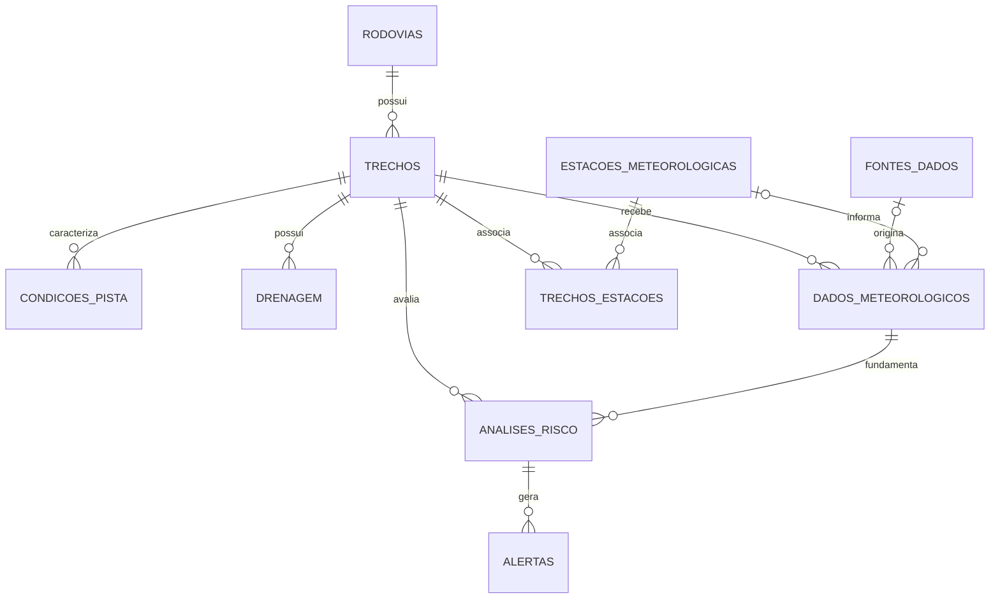

# Banco de dados e persistência

Modo mock: arquivos JSON iniciais e estado em memória; alterações, medições, análises e alertas não sobrevivem ao reinício. Modo real: PostgreSQL/PostGIS via psycopg, com configuração na raiz `.env`. Não há execução automática de migrations. A campanha V2 não conectou um banco real.

## Modelo lógico

| Tabela | Conteúdo |
|---|---|
| rodovias | Identificação e estado |
| trechos | Intervalo, dimensões, geometria, origem, inclinação e parâmetros WD |
| condicoes_pista | Pavimento e proveniência |
| drenagem | Capacidade individual/total, quantidade, origem e observação |
| fontes_dados | Cadastro de fontes |
| dados_meteorologicos | Precipitação, intensidade, data/hora, modo, estação e identificador externo |
| estacoes_meteorologicas | Cadastro e localização de estações |
| trechos_estacoes | Associação e validação de representatividade |
| analises_risco | Resultado, dados usados JSONB, versão, ausências e status |
| alertas | Mensagem, estado, validade, deduplicação e vínculo com análise |

## Migrations
Para uma instalação de desenvolvimento em banco vazio, após criar banco e usuário e disponibilizar PostGIS, executar os scripts uma vez, na ordem abaixo, com `psql -v ON_ERROR_STOP=1 -U aquasafe -d aquasafe -f database/migrations/<arquivo>`. Administrador deve habilitar PostGIS ou conceder permissões adequadas. Os nomes 004/005 se repetem; ambos os arquivos de cada grupo são necessários. A ordem abaixo é proposta pela dependência lógica e ainda requer teste em banco real.

1. 001_initial_schema.sql — modelo inicial
2. 002_backend_monitoramento.sql — monitoramento, estações, rastreabilidade de análise
3. 003_seed_br116_mock.sql — primeira região demonstrativa
4. 004_rastreabilidade_dados.sql — origem de pista e drenagem
5. 004_seed_br116_via_dutra_mock.sql — segunda região
6. 005_corrigir_observacao_drenagem.sql — compatibilização da observação
7. 005_update_via_dutra_test_geometry.sql — geometrias de teste
8. 006_update_via_dutra_candidate_geometries.sql — atualização de candidatos
9. 007_update_br116_osm_geometries.sql — traçados OSM

Os scripts de seed são demonstrativos; não importar em base operacional sem avaliação. Não executar schema.sql e 001 juntos indiscriminadamente. Fazer backup antes de alterações e verificar constraints, referências e contagem de registros.

Configuração: `DATA_MODE=real`, `DATABASE_URL` ou DB_HOST/DB_PORT/DB_NAME/DB_USER/DB_PASSWORD, `AQUASAFE_API_KEY` obrigatória. Usar credenciais locais seguras, nunca versioná-las. Em V2 não há fallback da declividade longitudinal para WD. Geometrias sem validação não são elegíveis como segmento atual no modo real. A associação de estações e os parâmetros simulados não se tornam reais pela troca de modo.
